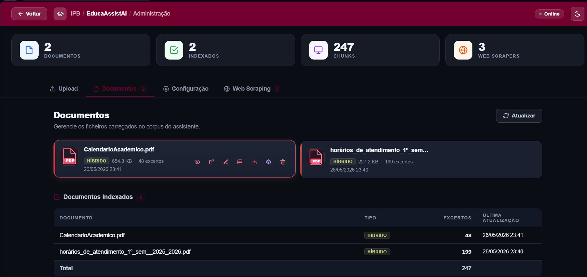
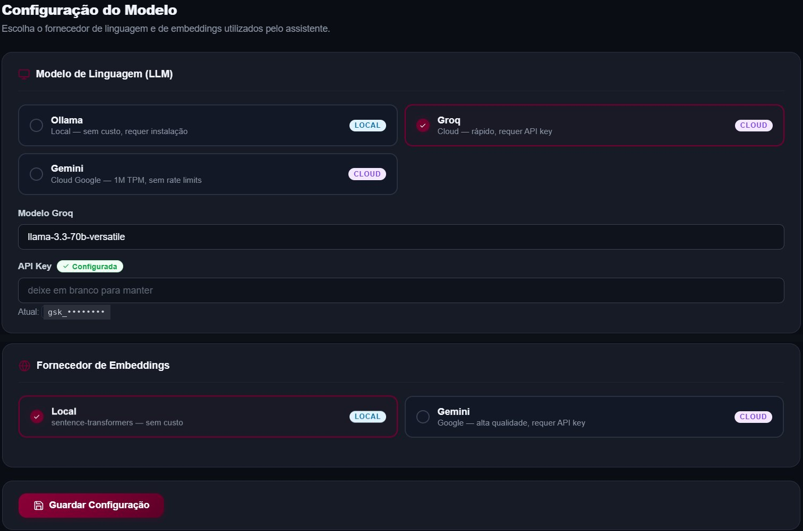

# EducaAssistAI

Assistente conversacional com RAG (Retrieval-Augmented Generation) para consulta de documentação institucional do IPB. Responde com base nos documentos carregados e recusa responder quando a informação não existe nesses documentos.

| Painel de administração | Configuração de modelos |
|---|---|
|  |  |

## Funcionalidades

- Perguntas em linguagem natural sobre documentos institucionais (PDF e texto)
- Pesquisa híbrida: vetorial (ChromaDB) e léxica (BM25), com os resultados fundidos por Reciprocal Rank Fusion
- Extração de PDFs em três modos (markdown, tabela, texto), com seleção automática e fallback
- Mecanismo de recusa: quando não há evidência nos documentos, o sistema não inventa uma resposta
- LLM e embeddings intercambiáveis por configuração

## Arquitetura

```
Angular (frontend)
      │  HTTP
      ▼
FastAPI (backend)
      ├── Pipeline RAG: recuperação híbrida → composição da resposta via LLM
      ├── Pipeline de ingestão: extração de PDFs → chunking → embeddings
      ▼
ChromaDB (vetores) · BM25 (léxico) · SQLite (conversas e metadados)
```

Todos os clientes de LLM implementam a interface `BaseLLMClient`, por isso trocar de fornecedor não altera a lógica RAG.

## Requisitos

- Python 3.9 ou superior (desenvolvido com 3.9.13)
- Node.js (LTS compatível com Angular 17)
- [Ollama](https://ollama.com), apenas se usares o LLM local

## Instalação

Backend (na raiz do projeto):

```bash
python -m venv .venv

# Windows
.venv\Scripts\activate
# Linux / macOS
source .venv/bin/activate

pip install -r requirements.txt
```

Frontend:

```bash
cd frontend
npm install
```

## Configuração

Copia `.env.example` para `.env` e preenche o que precisares. O ficheiro `.env` contém chaves de API e não deve ser commitado.

| Variável | Valores | Por defeito | Descrição |
|---|---|---|---|
| `LLM_PROVIDER` | `ollama`, `groq`, `gemini` | `ollama` | Fornecedor do LLM |
| `EMBED_PROVIDER` | `local`, `gemini` | `local` | Fornecedor dos embeddings |
| `OLLAMA_URL` / `OLLAMA_MODEL` | | `http://localhost:11434` / `gemma2:2b` | Ollama local |
| `GROQ_API_KEY` / `GROQ_MODEL` | | `llama-3.3-70b-versatile` | Groq (cloud, tier gratuito) |
| `GEMINI_LLM_API_KEY` / `GEMINI_LLM_MODEL` | | `gemini-2.5-flash` | Gemini como LLM |
| `GOOGLE_API_KEY` | | | Gemini para embeddings (usada também como fallback da chave do LLM) |

Chaves gratuitas: [Groq](https://console.groq.com/keys) e [Google AI Studio](https://aistudio.google.com/apikey). Não requerem cartão de crédito.

## Execução

1. **LLM local (opcional):**

   ```bash
   ollama pull gemma2:2b
   ollama serve
   ```

2. **Backend** (a partir da raiz do projeto):

   ```bash
   uvicorn backend.app:app --reload
   ```

3. **Frontend:**

   ```bash
   cd frontend
   npm start
   ```

   A aplicação fica disponível em `http://localhost:4200`.

Para confirmar o fornecedor em uso, consulta `GET /health/llm` e `GET /health/embeddings`, ou vê os badges no canto superior da interface.

## Documentos

Os documentos são adicionados no **painel de Administração** da interface:

- **Upload de PDFs:** o ficheiro é guardado em `backend/data/`, extraído, dividido em chunks e indexado.
- **Scrapers:** páginas do site institucional podem ser recolhidas e indexadas a partir do mesmo painel.

Ao arrancar, o sistema não indexa automaticamente ficheiros copiados à mão para `backend/data/`. Com o índice vazio, o assistente responde a pedir que sejam adicionados documentos.

Cada provider de embeddings tem a sua própria coleção ChromaDB (`ipb_docs_v3_local` ou `ipb_docs_v3_gemini`), porque vetores de espaços diferentes não são comparáveis. Trocar de provider exige carregar os documentos nesse modo uma vez.

## Extração de PDFs

| Modo | Biblioteca | Quando é usado |
|---|---|---|
| `markdown` (defeito) | PyMuPDF4LLM | PDFs com prosa e tabelas |
| `table` | PyMuPDF `find_tables` | Horários e listas com uma identidade clara por linha |
| `text` | PyMuPDF `get_text` | PDFs simples, como fallback |

A escolha automática descarta o modo tabular quando os chunks resultantes são ilegíveis. Para forçar um modo:

```bash
curl -X POST -H "Content-Type: application/json" \
     -d '{"mode":"markdown"}' \
     http://localhost:8000/documents/NomeDoFicheiro.pdf/reextract
```

## API

| Método | Rota | Descrição |
|---|---|---|
| GET | `/health` | Estado geral |
| GET | `/health/llm` | Fornecedor, modelo e disponibilidade do LLM |
| GET | `/health/embeddings` | Fornecedor, modelo, dimensão, coleção e contagem |
| POST | `/query` | Pergunta ao assistente |
| POST | `/upload` | Carregar PDF |
| GET | `/documents` | Listar documentos |
| GET | `/documents/{filename}/file` | Servir o PDF |
| PATCH | `/documents/{filename}/rename` | Renomear documento |
| POST | `/documents/{filename}/reextract` | Re-extrair com outro modo |
| DELETE | `/documents/{filename}` | Apagar documento |
| GET, POST | `/conversations` | Listar e criar conversas |
| GET, PATCH, DELETE | `/conversations/{id}` | Gerir uma conversa |
| GET, POST | `/admin/scrapers` | Gerir scrapers do site institucional |
| POST | `/admin/scrapers/{id}/run` | Executar um scraper |

A documentação interativa completa está em `http://localhost:8000/docs` (gerada pelo FastAPI).

## Estrutura

```
backend/
  app.py            Endpoints REST (FastAPI)
  answer.py         Composição da resposta via LLM
  retrieval.py      Pesquisa híbrida (ChromaDB + BM25)
  ingest.py         Carregamento de PDFs e texto
  chunk.py          Divisão em chunks
  pdf_tables.py     Extração tabular
  schema_store.py   Registo persistente de esquemas tabulares
  llm_client.py     Abstração unificada Ollama / Groq / Gemini
  vision.py         Extração de PDFs digitalizados
  conversations.py  Histórico de conversas
frontend/           Interface Angular 17
requirements.txt    Dependências Python
```

## Avaliação

Benchmark com **160 perguntas reais** em 8 categorias (20 por categoria), construído a partir de dois documentos institucionais (calendário académico e horários de atendimento). Os resultados são os do relatório final do projeto.

**Configuração testada:** gerador `llama-3.1-8b-instant` (Groq), embeddings `paraphrase-multilingual-MiniLM-L12-v2` locais (384 dimensões), 247 excertos indexados.

### Recusa (anti-alucinação)

Nas 40 perguntas sem resposta nos documentos ou com premissas falsas, o sistema recusou ou corrigiu a premissa em **40/40 casos (1,00)**. Não foram observadas alucinações.

### Recuperação

| Categoria | Recall@5 | Recall@20 | NDCG@10 | MRR |
|---|---|---|---|---|
| Factual | 0,90 | 1,00 | 0,76 | 0,72 |
| Restrição | 0,86 | 1,00 | 0,87 | 0,82 |
| Multi-hop | 0,71 | 0,98 | 0,91 | 1,00 |
| Conversacional | 0,80 | 0,90 | 0,65 | 0,54 |
| Listagem | 0,46 | 0,80 | 0,74 | 0,68 |

### Correção das respostas

Avaliada por um modelo juiz independente (`openai/gpt-oss-120b`). Correção = Correto + 0,5 × Parcial.

| Categoria | Correto | Parcial | Incorreto | Correção |
|---|---|---|---|---|
| Factual | 0,90 | 0,00 | 0,10 | **0,90** |
| Listagem | 0,35 | 0,45 | 0,20 | 0,57 |
| Restrição | 0,25 | 0,15 | 0,60 | 0,33 |
| Conversacional | 0,20 | 0,00 | 0,80 | 0,20 |

**Multi-hop (ablação do gerador):** com o mesmo retriever e o mesmo contexto, a correção sobe de 0,00 com `llama-3.1-8b-instant` (que se abstém) para **0,93** com `llama-3.3-70b-versatile`. A limitação está na capacidade de síntese do modelo pequeno, não na recuperação.

**Contagem:** acerto exato de 0,05 (0,15 com tolerância de ±1). Contar sobre todo o corpus exige uma consulta estruturada, não recuperação semântica.

### Leitura dos resultados

- A recuperação híbrida é forte: Recall@20 de 1,00 nas perguntas factuais e de restrição.
- A recusa é fiável: o sistema prefere admitir que não sabe a inventar.
- As listagens são o ponto fraco da recuperação, porque o reranking limita a 6 os excertos por ficheiro.
- As perguntas de seguimento são bem recuperadas, mas a síntese da resposta falha com o modelo de 8B.

Os scripts de avaliação estão em `benchmark/` (`evaluate.py`, `judge.py`) e em `backend/eval/`.

## Autor

Cláudio Azevedo · Engenharia Informática, IPB/ESTiG, 2026
